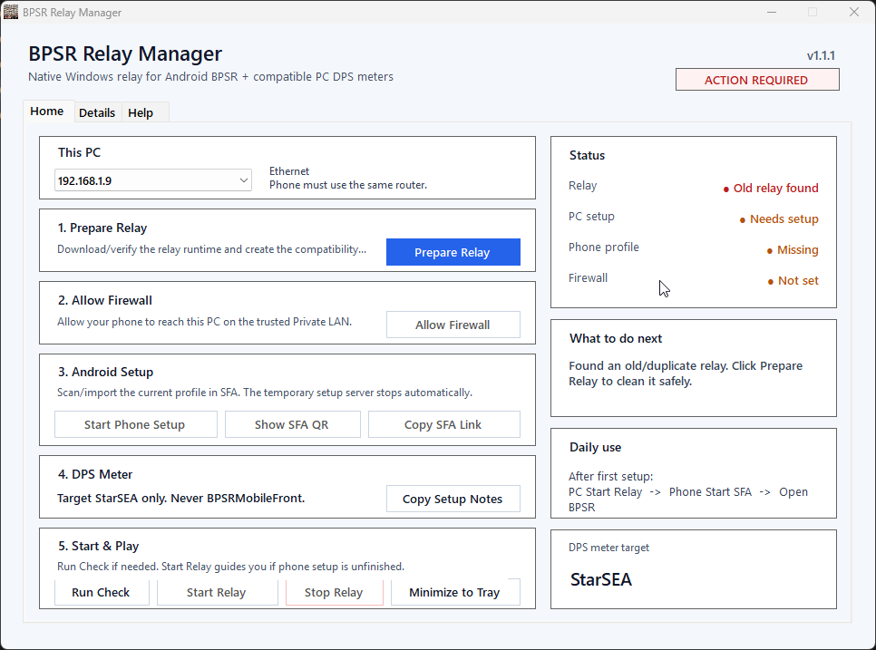

# BPSR Android DPSMeter Relay

Windows helper that forwards **Blue Protocol: Star Resonance combat traffic from an Android phone to a compatible PC DPS meter**. The relay is **DPS-meter agnostic**: it forwards traffic and does not calculate DPS itself.

[Download latest release](https://github.com/Zudin987/BPSR-Android-DPSMeter-Relay/releases/latest) · [Project website](https://zudin987.github.io/projects/android-relay/)

<p align="center">
  
</p>

## Requirements

- Windows PC and Android phone on the **same trusted home/private LAN**.
- SFA (sing-box for Android) installed on the phone.
- A separate Windows DPS meter compatible with BPSR traffic from **StarSEA**.
- Administrator approval to create the Windows firewall rule.

## Get started

1. [Download the latest ZIP](https://github.com/Zudin987/BPSR-Android-DPSMeter-Relay/releases/latest/download/BPSR-Android-DPSMeter-Relay.zip). Extract **everything**, then run `BPSR Relay Manager.exe`.
2. Choose the PC address on the same network as your phone. In order, select **Prepare Relay → Allow Firewall → Start Phone Setup**.
3. Import the profile into SFA and route **BPSR only** through it. For a lasting one-time setup, download `android-bpsr-relay.json` from the phone setup page and use SFA's **Import from file** option. If using the QR's **remote profile** shortcut instead, turn **Auto Update off** for that profile in SFA after import: its private setup URL is available for only five minutes and is closed before the relay starts. A later remote-profile refresh cannot reach that temporary URL; the saved profile may still work, but remote updating cannot.
4. Select **Start Relay** on the PC, start SFA on the phone, then open BPSR.
5. In your Windows DPS meter, select **StarSEA** as the capture/process target, **not** `BPSRMobileFront`.

For daily use: **Start Relay on PC → Start SFA on phone → Open BPSR**. The manager's tray menu can reopen it, start or stop the relay, or exit.

## Experimental voice-chat compatibility

SFA's per-app mode routes **the whole BPSR app**, not just combat traffic. Some users report in-game voice-chat problems while the relay is active. No BPSR voice-server IPs/domains have been independently verified, so **the default is unchanged** and no guessed voice endpoints are bypassed.

To try a *selective* exception, use **Details → Voice Routing** in the manager. It opens `output/voice-routing.txt`. Add only destinations **verified** to carry voice, one per line:

```text
domain:voice.your-verified-provider.example
ip:203.0.113.50/32
```

The examples are placeholders, not actual BPSR destinations. Domain entries match that domain and its subdomains; IP entries must be narrow IPv4 CIDRs (/24 through /32). Matched connections go directly from the phone instead of through StarSEA. Everything else still goes through the PC relay. Note that domain matching depends on DNS visibility; IP CIDRs can be more dependable for IP-only connections.

**Last-resort test only:** Add `udp:direct` to bypass **all UDP** (except DNS handled by SFA). This may restore UDP-based voice but could hide UDP gameplay from the DPS meter, so **do not assume DPS completeness**. Remove that line if combat tracking changes.

After any edit: **Stop Relay → Prepare Relay → reimport the generated JSON as a local profile in SFA → Start Relay → restart SFA and BPSR**. The manager rejects stale profiles when the routing file changes. Compare voice and DPS with and without the bypass; a Windows UDP smoke test does not prove real Android voice compatibility. Do not publish a stable release without real-device testing.

## Important network safety

- Use this tool **only on a trusted home/private LAN**. Never port-forward port `10808`.
- The phone-to-PC hop uses **authenticated SOCKS5** but **is not encrypted**.
- The setup QR is **generated locally** on the PC, not sent to an external QR service. Do not share the QR profile or relay credentials.
- Repeat phone setup if the PC's LAN address changes. The temporary profile URL cannot be used as a permanent subscription.

The native Windows manager handles setup, diagnostics and relay processes; PowerShell files in the repository are developer/CI tooling, not part of the user release. The relay does not modify game files.

## Troubleshooting

Open **Details** for diagnostics or **Help** for setup guidance. If the phone cannot connect, check the PC address, private-network firewall rule and SFA profile. If the meter is empty, check that its target is **StarSEA**. Include the app version, connection type and meter name when reporting a problem, but never include credentials.

Unofficial community tool; not affiliated with BPSR, SFA, sing-box or any DPS-meter project.
